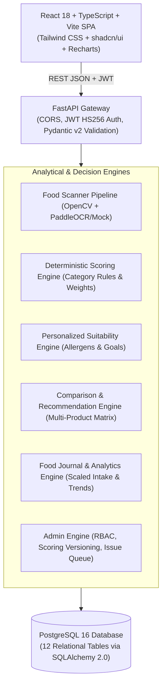

# NutriLens – Packaged Food Intelligence Platform

> **Final-Year B.Tech Major Project**  
> *A personalized packaged-food intelligence system providing deterministic nutritional quality scoring, explainable allergen safeguards, personalized dietary suitability matching, multi-product tradeoff comparison, and an intentional consumption journal.*

---

## 📑 Table of Contents
1. [Project Overview](#project-overview)
2. [Core Architectural Principles](#core-architectural-principles)
3. [System Architecture](#system-architecture)
4. [Technology Stack](#technology-stack)
5. [Repository Structure](#repository-structure)
6. [Prerequisites & System Requirements](#prerequisites--system-requirements)
7. [Step-by-Step Setup Guide](#step-by-step-setup-guide)
   - [Local PostgreSQL with Docker](#local-postgresql-with-docker)
   - [Backend Service Setup (FastAPI)](#backend-service-setup-fastapi)
   - [Database Migrations & Seeding](#database-migrations--seeding)
   - [Frontend Web Application (React + Vite)](#frontend-web-application-react--vite)
8. [Automated Testing & Verification](#automated-testing--verification)
9. [End-to-End User Journey Demonstration](#end-to-end-user-journey-demonstration)
10. [Production Deployment Guide](#production-deployment-guide)
    - [Frontend Deployment (Vercel)](#frontend-deployment-vercel)
    - [Backend Deployment (Render / Docker)](#backend-deployment-render--docker)
    - [Database & Storage (Supabase PostgreSQL)](#database--storage-supabase-postgresql)
11. [Environment Variables Reference](#environment-variables-reference)
12. [Known Limitations & Design Boundaries](#known-limitations--design-boundaries)

---

## 1. Project Overview

Modern packaged foods frequently present confusing nutrition panels, complex ingredient chemical names, and obscure allergen declarations. Consumers with food allergies, chronic conditions (e.g., diabetes, hypertension), or strict ethical dietary choices (e.g., vegan, vegetarian, Jain) struggle to decode these labels accurately.

**NutriLens** solves this by providing:
- **Computer Vision Label Scanner**: Captures or uploads food packaging images, preprocessed with OpenCV and digitized with PaddleOCR.
- **Standardized Fact Extraction**: Extracts nutrition facts, normalized ingredients, and allergen declarations with structured uncertainty awareness.
- **Deterministic NutriLens Scoring (0–100)**: Category-calibrated nutrient profiling that penalizes excess sugars, sodium, saturated fat, and trans fats while rewarding protein, fibre, and low energy density.
- **Personalized Dietary Suitability Engine**: Evaluates individual allergies, restrictions, and goals completely independent of the product's general nutrition score.
- **Multi-Product Comparison & Tradeoff Matrix**: Side-by-side product comparisons with priority ranking and traceable healthier alternative recommendations.
- **Intentional Food Consumption Journal**: Scaled intake tracking (`(weight / 100g) * nutrient`) with Recharts longitudinal trend visualizations.
- **Administrative Knowledge Base & RBAC**: Real-time platform statistics, product verification, ingredient taxonomy management, immutable scoring rule versioning, and community issue review.

---

## 2. Core Architectural Principles

- **Explainable Intelligence**: No generative LLM hallucinations for medical or nutritional facts. All scores and suitability outcomes are computed deterministically.
- **Honest Data Preservation**: Missing nutrients remain `None` or "Not Declared"; zero assumptions are made.
- **Declared vs. Precautionary Separation**: Explicit allergens (e.g. "Contains Soy") are strictly distinguished from facility warnings ("May contain traces of nuts").
- **Intentionality**: Scanning a product does NOT log it. Consuming a product requires explicit user logging.
- **Educational Scope**: Not statutory FSSAI certification or clinical medical advice.

---

## 3. System Architecture



---

## 4. Technology Stack

| Layer | Technologies |
|---|---|
| **Frontend** | React 18.3, TypeScript 5.5, Vite 5.4, Tailwind CSS 3.4, React Router 6.26, TanStack Query 5.56, Recharts 2.12, Lucide React, Axios |
| **Backend** | Python 3.11, FastAPI 0.115, SQLAlchemy 2.0.36, Pydantic v2.9, Alembic 1.13, Pytest 8.3, Uvicorn, Pillow, OpenCV, PaddleOCR |
| **Database** | PostgreSQL 16 (local Docker / Supabase PostgreSQL), Connection pooling via SQLAlchemy |
| **Security** | Salted bcrypt password hashing, HS256 JWT access tokens, role-based access control (`require_admin_user`) |
| **Deployment** | Vercel (Frontend), Render / AWS / Docker (Backend), Supabase (PostgreSQL & Storage) |

---

## 5. Repository Structure

```text
Major_Project/
├── README.md                                 # Top-level workspace documentation
├── HANDOFF.md                                # Detailed state handoff log
├── docs/                                     # Comprehensive architectural documentation
│   ├── PROJECT_SPEC.md                       # Full product specification
│   ├── ARCHITECTURE.md                       # System architecture & engine specs
│   ├── DATABASE_SCHEMA.md                    # Database ER diagram & table schemas
│   ├── API_DOCUMENTATION.md                  # Complete REST API reference
│   ├── PROGRESS.md                           # Milestone verification log
│   └── DECISIONS.md                          # Architecture Decision Records (ADRs)
└── nutrilens/
    ├── docker-compose.yml                    # Multi-container local orchestration
    ├── render.yaml                           # Render Cloud deployment blueprint
    ├── backend/                              # FastAPI Python backend
    │   ├── alembic/                          # Database migrations
    │   ├── app/
    │   │   ├── api/                          # REST endpoints (auth, catalogue, scans, scoring, suitability, comparison, journal, admin)
    │   │   ├── core/                         # Settings & JWT security
    │   │   ├── database/                     # SQLAlchemy engine & session factory
    │   │   ├── models/                       # 12 SQLAlchemy ORM models
    │   │   ├── schemas/                      # Pydantic v2 schemas
    │   │   ├── food_scanner/                 # CV & OCR label parsing engine
    │   │   ├── scoring_engine/               # Deterministic 0-100 scoring engine
    │   │   ├── suitability_engine/           # Personalized suitability engine
    │   │   ├── comparison_engine/            # Product comparison & recommendation engine
    │   │   ├── journal_engine/               # Scaled consumption & analytics engine
    │   │   └── seed.py                       # Database seed script
    │   ├── tests/                            # Comprehensive Pytest automated test suite
    │   └── requirements.txt
    └── frontend/                             # React 18 + Vite frontend
        ├── src/
        │   ├── components/                   # UI primitives, charts, modals, comparison cards
        │   ├── context/                      # AuthContext
        │   ├── layouts/                      # AppLayout (with admin portal) & RootLayout
        │   ├── pages/                        # 12 complete responsive application pages
        │   ├── services/                     # Axios API service client
        │   └── types/                        # TypeScript definitions
        ├── package.json
        └── vercel.json                       # Vercel SPA routing rewrite rules
```

---

## 6. Prerequisites & System Requirements

- **Operating System**: Windows 10/11, macOS, or Ubuntu 20.04+
- **Python**: Version 3.11.x
- **Node.js**: Version 20.x or 22.x LTS with `npm`
- **Docker & Docker Compose**: Optional for running local PostgreSQL container

---

## 7. Step-by-Step Setup Guide

### Local PostgreSQL with Docker
```bash
cd nutrilens
docker-compose up -d db
```
The database runs on `localhost:5432` with database `nutrilens_db`, user `nutrilens_user`, password `nutrilens_password`.

### Backend Service Setup (FastAPI)
```bash
cd nutrilens/backend

# Create virtual environment
python -m venv venv

# Activate virtual environment
# Windows PowerShell:
.\venv\Scripts\Activate.ps1
# Linux / macOS:
# source venv/bin/activate

# Install dependencies
pip install -r requirements.txt -r requirements-dev.txt

# Configure environment variables
cp .env.example .env
```

### Database Migrations & Seeding
```bash
# Apply all database migrations
alembic upgrade head

# Seed canonical ingredients, allergens, demo products, default admin, and scoring rule
python app/seed.py
```

### Start Backend Development Server
```bash
uvicorn app.main:app --host 0.0.0.0 --port 8000 --reload
```
- API Base: `http://localhost:8000`
- Interactive OpenAPI Docs: `http://localhost:8000/api/v1/docs`

### Frontend Web Application (React + Vite)
```bash
cd nutrilens/frontend

# Install dependencies
npm install

# Configure environment variables
cp .env.example .env

# Run development server
npm run dev
```
Accessible in your browser at: `http://localhost:5173`

---

## 8. Automated Testing & Verification

### Run Full Backend Test Suite
```bash
cd nutrilens/backend
pytest -v
```
**Test Coverage**: All 109+ tests pass across:
- Authentication & User Profiles (`test_auth.py`)
- Catalogue & Taxonomy (`test_catalogue.py`)
- Food Scanner Pipeline (`test_scanner.py`)
- Deterministic Scoring (`test_scoring.py`)
- Personalized Suitability (`test_suitability.py`)
- Product Comparison & Alternatives (`test_comparison.py`)
- Food Journal & Consumption Scaling (`test_journal.py`)
- Admin RBAC & Knowledge Management (`test_admin.py`)
- Full User Journey Integration (`test_full_journey_integration.py`)

### Run Frontend Type Check & Build
```bash
cd nutrilens/frontend
npx tsc --noEmit
npm run build
```
Result: 0 TypeScript errors; builds production bundle in `dist/`.

---

## 9. End-to-End User Journey Demonstration

| Step | User Action | System Outcome |
|---|---|---|
| **1. Registration** | Register as a new user with email & password | Salted bcrypt hash stored; JWT token returned |
| **2. Profile Setup** | Configure dietary preferences (e.g., Vegan, Tree Nut allergy, Low Sugar goal) | User profile saved in PostgreSQL `user_profiles` table |
| **3. Food Scanning** | Upload a packaging label photo on `/scan` | OpenCV preprocessing applied; PaddleOCR digitizes text |
| **4. OCR Correction** | Review extracted title, ingredients, and nutrition facts; make edits | User edits preserved in `corrected_data` JSONB |
| **5. Confirmation** | Confirm product | Product committed to catalog; per-100g nutrition facts saved |
| **6. Scoring** | View product analysis on `/catalogue/:id` | Deterministic NutriLens score (0–100), Grade (A–E), factor breakdown |
| **7. Suitability** | Inspect personalized suitability card | Evaluated against user profile: checks conflicts, cautions, safety warnings |
| **8. Comparison** | Select 2+ products on `/compare` | Side-by-side comparison matrix with priority winners (e.g. Lower Sugar) |
| **9. Alternatives** | Review recommended alternatives | Healthier catalogue alternatives suggested with traceable reasons |
| **10. Food Journal** | Click "Log in Journal" and enter 150g consumed | Scaled intake computed (150% of per-100g); logged to `/journal` |
| **11. Analytics** | View `/analytics` | 7-day weekly trends, 30-day monthly overviews, Recharts visualizations |
| **12. Admin Portal** | Sign in as admin (`admin@nutrilens.com` / `Admin123!`) | Access `/admin`: live database KPIs, verify products, manage scoring rules |

---

## 10. Production Deployment Guide

### Frontend Deployment (Vercel)
1. Import `nutrilens/frontend` into Vercel.
2. Framework Preset: **Vite**.
3. Build Command: `npm run build`.
4. Output Directory: `dist`.
5. Environment Variable:
   - `VITE_API_BASE_URL`: `https://your-backend-domain.com`
6. `vercel.json` rewrite configuration handles client-side routing automatically.

### Backend Deployment (Render)
1. Push repository to GitHub.
2. Use the included blueprint `nutrilens/render.yaml` or create a Web Service:
   - Root Directory: `nutrilens/backend`
   - Build Command: `pip install -r requirements.txt && alembic upgrade head && python app/seed.py`
   - Start Command: `uvicorn app.main:app --host 0.0.0.0 --port $PORT`
3. Configure Environment Variables (refer to `.env.production.example`).

### Database & Storage (Supabase PostgreSQL)
1. Create a new Supabase project.
2. Copy the Connection String URI from Project Settings → Database.
3. Set `DATABASE_URL` in backend environment variables.
4. Run migrations: `alembic upgrade head`.

---

## 11. Environment Variables Reference

| Variable | Environment | Description |
|---|---|---|
| `DATABASE_URL` | Backend | PostgreSQL connection string |
| `SECRET_KEY` | Backend | Secret key for JWT cryptographic signing (HS256) |
| `ENVIRONMENT` | Backend | `development` or `production` |
| `DEBUG` | Backend | `True` or `False` |
| `BACKEND_CORS_ORIGINS` | Backend | JSON list of permitted frontend origins |
| `ACCESS_TOKEN_EXPIRE_MINUTES` | Backend | Expiry for user access tokens (default: `10080` = 7 days) |
| `VITE_API_BASE_URL` | Frontend | URL of backend API Gateway |

---

## 12. Known Limitations & Design Boundaries

1. **OCR Physical Condition**: Highly reflective metallic foils, crumpled plastic wrappers, or very low-resolution images (< 600px) may degrade OCR precision; NutriLens provides an interactive manual review editor before catalogue confirmation.
2. **Deterministic Category Bounds**: Scoring thresholds are calibrated for common packaged grocery categories; unusual artisanal foods fall back to general packaged food rules.
3. **Non-Medical Boundary**: NutriLens evaluations do not replace statutory FSSAI compliance testing or physician medical directives.
