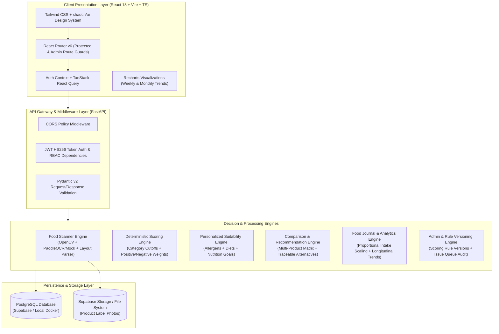
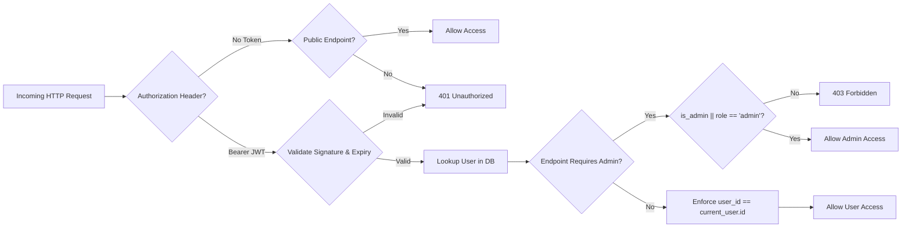

# NutriLens – Comprehensive System Architecture & Engineering Specifications

## 1. System Architecture Overview

NutriLens is architected as a high-performance, decoupled packaged-food intelligence platform. The system operates on strict principles of determinism, data isolation, transparent nutrient accounting, and non-medical consumer guidance.

---

## 2. Subsystem Breakdown

### 2.1 Food-Label Scanning Pipeline (`app/food_scanner/`)
- **Image Preprocessor** (`preprocessor.py`): Ingests user-submitted image files (JPEG, PNG, WebP). Enforces strict physical size limits (maximum 10MB), checks format headers via PIL, and applies OpenCV transformations: EXIF orientation correction, CLAHE (Contrast Limited Adaptive Histogram Equalization), and bilateral filtering for noise reduction while preserving text edges.
- **OCR Engine Adapter** (`ocr_engine.py`): Pluggable adapter interface supporting `PaddleOCREngine` (deep learning text detection and angle classification), `FallbackOCREngine` (graceful manual transcription fallback), and `MockOCREngine` for isolated test environments.
- **Structured Extractor** (`extractor.py`): Multi-pattern regex and lexical tokenizer extracting product title, brand name, serving size, per-100g/ml nutritional tables, ingredients, declared allergens, and precautionary statements. Flags uncertainty when confidence is below thresholds.
- **Scan Orchestration** (`service.py`): Manages the scan lifecycle: `uploaded` → `processing` → `extracted` → `corrected` → `confirmed`.

### 2.2 Deterministic Nutrition Scoring Engine (`app/scoring_engine/`)
- **Serving Normalizer** (`calculator.py`): Standardizes all nutrients to per 100g or per 100ml. Never assumes undeclared nutrients (unmentioned fields remain `None`).
- **Category-Aware Scoring Rules** (`rules.py`): Calibrated rules across product categories:
  - Beverages
  - Biscuits & Cookies
  - Breakfast Cereals
  - Dairy Products
  - Snacks & Namkeen
  - Chocolates & Sweets
  - Instant Foods & Ready Meals
  - General Packaged Foods
- **Penalties & Bonuses**: Penalizes excessive free/added sugars, sodium, saturated fat, and trans fats (severe penalty). Grants positive points for dietary fibre, protein, and low energy density.
- **Score Completeness Guard**: If critical macronutrients are missing, returns `status: "insufficient_data"` with zero fabricated scores.
- **Immutable Rule Versions**: Every score output references its exact rule version (e.g. `nutrilens-score-v1.0`).

### 2.3 Personalized Dietary Suitability Engine (`app/suitability_engine/`)
- **Independence Principle**: Personal suitability is strictly decoupled from the general NutriLens score. A product retains its general nutrition score regardless of an individual user's profile.
- **Four Standard Result Statuses**:
  1. `Suitable based on available information`: No declared conflicts detected.
  2. `Caution`: Precautionary statements ("May contain") or moderate threshold flags.
  3. `Declared restriction conflict`: Product explicitly contains an allergen or violates a strict dietary boundary (e.g., non-vegetarian ingredients for a vegetarian).
  4. `Insufficient information`: Critical ingredient data missing.
- **Safety Disclaimers**: Disclaims medical diagnosis or treatment advice; explicitly states that absence of detected allergens does not guarantee allergen-free status.

### 2.4 Product Comparison & Healthier Alternative Engine (`app/comparison_engine/`)
- **Multi-Product Matrix** (`comparator.py`): Compares 2 to 6 products side-by-side on normalized per-100g/ml metrics. Highlights missing values honestly rather than treating them as zero.
- **Priority Ranking**: Evaluates user priorities (`lower_sugar`, `lower_sodium`, `lower_saturated_fat`, `higher_protein`, `higher_fibre`, `fewer_restriction_conflicts`) with winner trophies and trade-off commentary.
- **Traceable Recommendations** (`recommendations.py`): Identifies healthier catalogue alternatives within the same or compatible category, verifies higher NutriLens score, excludes user-declared allergen conflicts, and provides human-readable reasons (e.g., "+35% more fibre, 50% less sugar").

### 2.5 Food Consumption Journal & Longitudinal Analytics (`app/journal_engine/`)
- **Intentionality Principle**: Scanning a product never logs it. Consumption must be explicitly logged by the authenticated user with a confirmed quantity and date.
- **Proportional Scaling** (`calculator.py`): Scales per-100g values strictly by consumed weight (`consumed_weight_g / 100.0`). Missing nutrients remain `None` and are itemized in `missing_nutrients`.
- **Aggregated Summaries & Trends** (`analytics.py`):
  - Daily summary: Meals grouped into Breakfast, Lunch, Dinner, Snacks, and Other.
  - Weekly analytics: 7-day longitudinal daily trends with active-day averages.
  - Monthly analytics: 30-day intake distribution.
  - Frequent products: Consumption frequency and cumulative grams.
- **Reference Benchmarks**: Evaluates goal progress against established general population guidelines (WHO / ICMR-NIN) without inventing medical targets.

### 2.6 Admin RBAC & Knowledge Management (`app/api/v1/endpoints/admin.py`)
- **Backend Authorization**: `require_admin_user` dependency enforces admin roles (`is_admin=True` or `role in ["admin", "superadmin"]`) at the API route level with `403 FORBIDDEN`. Frontend navigation changes cannot bypass authorization.
- **Product & Ingredient CRUD**: Full management of products, verification toggles, canonical ingredient registry, INS/E-number taxonomy, and allergen classes.
- **Scoring Rule Versioning**: Configurable thresholds and factor weights stored with version strings. Creating a new version preserves all previous versions immutably.
- **Community Issue Queue**: User-reported inaccuracies (`POST /api/products/{id}/report-issue`) reviewed and resolved with admin audit notes.

---

## 3. Security, Authorization & Data Isolation Architecture

1. **Password Security**: Passwords hashed using bcrypt with cryptographically secure salts.
2. **Stateless Tokens**: HS256 JWT tokens containing `sub` (user email), issued on successful login/registration.
3. **User Isolation**: Journal logs, scan histories, issue reports, and profile preferences enforce strict `user_id == current_user.id` query scoping. Users cannot access or mutate each other's data.
4. **File Upload Restrictions**: 10MB maximum limit, MIME type whitelist (`image/jpeg`, `image/png`, `image/webp`), and file content integrity verification.
