# NutriLens – Production Database Schema & Entity Relationships

## 1. Overview
NutriLens utilizes PostgreSQL as its primary ACID transactional datastore, managed via SQLAlchemy 2.0 ORM and Alembic migrations. The database schema enforces relational integrity across consumer accounts, nutritional profiles, canonical taxonomies, product catalogs, scanned label records, consumption journals, dynamic scoring engine versions, and community data review queues.

---

## 2. Mermaid Entity-Relationship Diagram

```mermaid
erDiagram
    USERS ||--o| USER_PROFILES : "has"
    USERS ||--o{ SCANS : "submits"
    USERS ||--o{ FOOD_JOURNAL_ENTRIES : "logs"
    USERS ||--o{ PRODUCT_ISSUES : "reports"
    PRODUCTS ||--o| NUTRITION_FACTS : "has standardized per-100g/ml"
    PRODUCTS ||--o{ PRODUCT_INGREDIENTS : "contains"
    INGREDIENTS ||--o{ PRODUCT_INGREDIENTS : "mapped in"
    PRODUCTS ||--o{ PRODUCT_ALLERGENS : "declares"
    ALLERGENS ||--o{ PRODUCT_ALLERGENS : "referenced in"
    PRODUCTS ||--o{ FOOD_JOURNAL_ENTRIES : "consumed in"
    PRODUCTS ||--o{ PRODUCT_ISSUES : "subject of"

    USERS {
        uuid id PK
        string email UK
        string hashed_password
        string full_name
        int age
        string role "user | admin | superadmin"
        boolean is_admin
        boolean is_active
        timestamp created_at
        timestamp updated_at
    }

    USER_PROFILES {
        uuid id PK
        uuid user_id FK
        string dietary_preference
        jsonb allergies
        jsonb dietary_restrictions
        jsonb nutrition_goals
        jsonb monitored_nutrients
        timestamp created_at
        timestamp updated_at
    }

    PRODUCTS {
        uuid id PK
        string name
        string brand
        string category
        string barcode UK
        string serving_size
        string serving_unit
        float package_size
        text description
        string label_image_url
        string data_source "scan | manual | seed"
        boolean is_demo_data
        boolean is_verified
        text verification_note
        text raw_ingredients_text
        timestamp created_at
        timestamp updated_at
    }

    NUTRITION_FACTS {
        uuid id PK
        uuid product_id FK
        float energy_kcal
        float total_fat_g
        float saturated_fat_g
        float trans_fat_g
        float cholesterol_mg
        float carbohydrates_g
        float total_sugar_g
        float added_sugar_g
        float dietary_fibre_g
        float protein_g
        float sodium_mg
        float calcium_mg
        float iron_mg
        float vitamin_c_mg
        string serving_unit
    }

    INGREDIENTS {
        uuid id PK
        string name UK
        string clean_name
        string category
        text description
        string concern_level "low | moderate | high"
        boolean is_additive
        string ins_number
        text source_evidence
        jsonb aliases
        timestamp created_at
        timestamp updated_at
    }

    PRODUCT_INGREDIENTS {
        uuid id PK
        uuid product_id FK
        uuid ingredient_id FK
        string original_text
        int order_index
        float ocr_confidence
        boolean is_verified
    }

    ALLERGENS {
        uuid id PK
        string name UK
        string code UK
        text description
    }

    PRODUCT_ALLERGENS {
        uuid id PK
        uuid product_id FK
        uuid allergen_id FK
        string declaration_type "declared | precautionary"
    }

    SCANS {
        uuid id PK
        uuid user_id FK
        text raw_ocr_text
        string status "uploaded | processing | extracted | corrected | confirmed"
        jsonb images
        jsonb extracted_data
        jsonb corrected_data
        timestamp created_at
        timestamp updated_at
    }

    FOOD_JOURNAL_ENTRIES {
        uuid id PK
        uuid user_id FK
        uuid product_id FK
        timestamp consumed_at
        string meal_type "breakfast | lunch | dinner | snack | other"
        float quantity
        float serving_size_g
        float total_weight_g
        jsonb scaled_nutrients
        text notes
        timestamp created_at
        timestamp updated_at
    }

    SCORING_RULE_VERSIONS {
        uuid id PK
        string version UK
        string name
        text description
        boolean is_active
        jsonb thresholds_food
        jsonb thresholds_beverage
        jsonb category_weights
        jsonb general_weights
        timestamp created_at
        timestamp updated_at
    }

    PRODUCT_ISSUES {
        uuid id PK
        uuid user_id FK
        uuid product_id FK
        string issue_type
        text description
        jsonb proposed_correction
        string status "pending | reviewed | resolved | rejected"
        text admin_notes
        uuid resolved_by FK
        timestamp created_at
        timestamp updated_at
    }
```

---

## 3. Database Table Definitions & Schema Constraints

### 3.1 `users`
Core user identity credentials with salted bcrypt password hashing and RBAC flags.
- `id` (UUID, Primary Key, default `gen_random_uuid()`)
- `email` (VARCHAR(255), Unique, Not Null, Indexed)
- `hashed_password` (VARCHAR(255), Not Null)
- `full_name` (VARCHAR(255), Not Null)
- `age` (INTEGER, Nullable)
- `role` (VARCHAR(50), Default `'user'`, Indexed)
- `is_admin` (BOOLEAN, Default `FALSE`, Indexed)
- `is_active` (BOOLEAN, Default `TRUE`)
- `created_at` / `updated_at` (TIMESTAMP WITH TIME ZONE, Default `now()`)

### 3.2 `user_profiles`
Personal dietary restrictions, allergy declarations, and tracked nutrient metrics.
- `id` (UUID, Primary Key)
- `user_id` (UUID, Foreign Key `users.id` ON DELETE CASCADE, Unique, Indexed)
- `dietary_preference` (VARCHAR(50), Default `'None'`) — e.g., Vegetarian, Vegan, Halal, Jain
- `allergies` (JSONB, Default `[]`) — Declared allergen classes (Peanuts, Tree nuts, Milk, etc.)
- `dietary_restrictions` (JSONB, Default `[]`) — Strict dietary boundaries (Gluten-free, Low-sodium, Sugar-free)
- `nutrition_goals` (JSONB, Default `[]`) — User aspirations (High Protein, High Fibre, Low Saturated Fat)
- `monitored_nutrients` (JSONB, Default `[]`) — Specific nutrients to track on journal dashboards

### 3.3 `products`
Verified and scanned packaged food product records.
- `id` (UUID, Primary Key)
- `name` (VARCHAR(255), Not Null, Indexed)
- `brand` (VARCHAR(255), Nullable, Indexed)
- `category` (VARCHAR(100), Nullable, Indexed) — e.g., `Breakfast Cereals`, `Beverages`, `Snacks`
- `barcode` (VARCHAR(50), Nullable, Indexed) — GTIN/EAN-13 barcode
- `serving_size` (VARCHAR(50), Nullable) — Raw packaging serving description (e.g., `30g (2 biscuits)`)
- `serving_unit` (VARCHAR(20), Default `'g'`)
- `package_size` (FLOAT, Nullable)
- `description` (TEXT, Nullable)
- `label_image_url` (VARCHAR(500), Nullable)
- `data_source` (VARCHAR(50), Default `'manual'`) — `'scan'`, `'manual'`, `'seed'`
- `is_demo_data` (BOOLEAN, Default `FALSE`)
- `is_verified` (BOOLEAN, Default `FALSE`, Indexed)
- `verification_note` (TEXT, Nullable)
- `raw_ingredients_text` (TEXT, Nullable)
- `created_at` / `updated_at` (TIMESTAMP WITH TIME ZONE)

### 3.4 `nutrition_facts`
Standardized nutrient values normalized strictly to per 100g or per 100ml.
- `id` (UUID, Primary Key)
- `product_id` (UUID, Foreign Key `products.id` ON DELETE CASCADE, Unique, Indexed)
- `energy_kcal` (FLOAT, Nullable)
- `total_fat_g`, `saturated_fat_g`, `trans_fat_g` (FLOAT, Nullable)
- `carbohydrates_g`, `total_sugar_g`, `added_sugar_g`, `dietary_fibre_g`, `protein_g` (FLOAT, Nullable)
- `sodium_mg`, `cholesterol_mg`, `calcium_mg`, `iron_mg`, `vitamin_c_mg` (FLOAT, Nullable)
- `serving_unit` (VARCHAR(20), Default `'g'`)

### 3.5 `ingredients` & `product_ingredients`
Standardized food chemical and botanical taxonomy mapping.
- `ingredients`: Canonical name, clean name, category (Preservative, Emulsifier, Sweetener), concern level (`low`, `moderate`, `high`), INS/E-number, source evidence, and synonym aliases (`JSONB`).
- `product_ingredients`: Association table binding products to standardized ingredients with order index, OCR confidence, and original label transcript text.

### 3.6 `allergens` & `product_allergens`
Allergen registry and declaration classifications.
- `allergens`: Standard allergen classes (Gluten, Milk, Eggs, Fish, Crustaceans, Tree nuts, Peanuts, Soybeans, Sesame, Mustard, Celery, Lupin, Molluscs, Sulphites).
- `product_allergens`: Association table specifying `declaration_type`:
  - `'declared'`: Stated directly in the ingredient list or "Contains" warning.
  - `'precautionary'`: "May contain" or "Manufactured in a facility that processes" statement.

### 3.7 `scans`
OCR scan pipeline state machine and audit record.
- `id` (UUID, Primary Key)
- `user_id` (UUID, Foreign Key `users.id` ON DELETE SET NULL, Nullable)
- `raw_ocr_text` (TEXT)
- `status` (`'uploaded'`, `'processing'`, `'extracted'`, `'corrected'`, `'confirmed'`, `'failed'`)
- `images` (`JSONB`) — List of image file paths, dimensions, and MIME types
- `extracted_data` (`JSONB`) — Raw pipeline parser output
- `corrected_data` (`JSONB`) — User manual review edits

### 3.8 `food_journal_entries`
Intentional food consumption log.
- `id` (UUID, Primary Key)
- `user_id` (UUID, Foreign Key `users.id` ON DELETE CASCADE, Indexed)
- `product_id` (UUID, Foreign Key `products.id` ON DELETE CASCADE, Indexed)
- `consumed_at` (TIMESTAMP WITH TIME ZONE, Not Null, Indexed)
- `meal_type` (VARCHAR(50), Not Null) — `'breakfast'`, `'lunch'`, `'dinner'`, `'snack'`, `'other'`
- `quantity` (FLOAT, Not Null) — Servings consumed
- `serving_size_g` (FLOAT, Not Null) — Grams per serving
- `total_weight_g` (FLOAT, Not Null) — Total grams consumed (`quantity * serving_size_g`)
- `scaled_nutrients` (`JSONB`, Not Null) — Proportional nutrient intake computed as `(total_weight_g / 100.0) * per_100_val`
- `notes` (TEXT, Nullable)

### 3.9 `scoring_rule_versions`
Immutable NutriLens scoring engine configurations.
- `id` (UUID, Primary Key)
- `version` (VARCHAR(50), Unique, Not Null) — e.g. `'nutrilens-score-v1.0'`
- `name` (VARCHAR(255), Not Null)
- `description` (TEXT, Nullable)
- `is_active` (BOOLEAN, Default `FALSE`, Indexed)
- `thresholds_food` (`JSONB`, Not Null) — Sugar, sodium, sat fat, trans fat, fibre, protein cutoffs for food
- `thresholds_beverage` (`JSONB`, Not Null) — Cutoffs for beverages
- `category_weights` (`JSONB`, Not Null) — Category-specific weighting modifiers
- `general_weights` (`JSONB`, Not Null) — Baseline positive and negative factor weights

### 3.10 `product_issues`
User-reported inaccuracies and administrator audit resolution queue.
- `id` (UUID, Primary Key)
- `user_id` (UUID, Foreign Key `users.id` ON DELETE CASCADE, Indexed)
- `product_id` (UUID, Foreign Key `products.id` ON DELETE CASCADE, Indexed)
- `issue_type` (VARCHAR(100), Not Null) — e.g. `incorrect_ingredients`, `inaccurate_nutrition`, `mislabeled_allergens`
- `description` (TEXT, Not Null)
- `proposed_correction` (`JSONB`, Nullable)
- `status` (VARCHAR(50), Default `'pending'`, Indexed) — `'pending'`, `'reviewed'`, `'resolved'`, `'rejected'`
- `admin_notes` (TEXT, Nullable)
- `resolved_by` (UUID, Foreign Key `users.id` ON DELETE SET NULL, Nullable)
